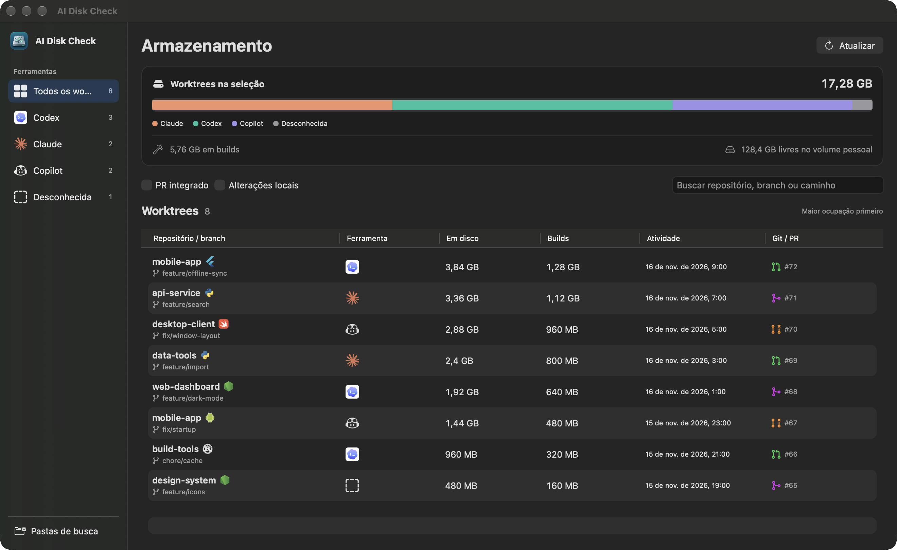

# AI Disk Check

Aplicativo nativo para macOS que mostra quanto espaço os worktrees do Git ocupam e permite limpar builds ou remover um worktree com prévia e confirmação.

A interface agrupa worktrees por ferramenta, incluindo Codex, Claude e GitHub Copilot. Selecione um item para ver o caminho, o espaço usado, a atividade Git e a situação do pull request. O painel indica quando a origem foi inferida. A consulta de PRs usa a autenticação local do GitHub CLI.



## Seleção múltipla

Na tabela, use **⌘ + clique** para adicionar ou retirar worktrees da seleção. Para selecionar um intervalo, clique na primeira linha e use **⇧ + clique** na última. Com dois ou mais worktrees selecionados, escolha uma das ações acima da tabela:

- **Limpar builds…** abre uma prévia das pastas de build de cada worktree. Desmarque as que deseja manter e confirme a limpeza.
- **Remover selecionados…** mostra as pastas que serão apagadas, os arquivos ignorados e as alterações locais de cada worktree. Se um commit em HEAD destacado precisar de proteção, a prévia indica a branch de backup que será criada. Ao escolher **Apagar mesmo assim**, você descarta as alterações sem commit.

A prévia identifica os worktrees que ficarão fora da operação. O app verifica cada item novamente antes de agir e mostra o resultado por worktree ao terminar. Se um item mudar após a confirmação, os demais ainda podem ser processados.

## Compilar e abrir

Em um Mac com macOS 14 ou posterior e as ferramentas de desenvolvimento do Xcode instaladas, execute na raiz do projeto:

```sh
./scripts/package.sh
open "dist/AI Disk Check.app"
```

O script gera um aplicativo assinado localmente e um ZIP para a arquitetura do Mac usado na compilação. Para executar os testes de aceitação, use `./scripts/test.sh`.

## Licença

O projeto usa a [licença MIT](LICENSE). Os avisos de licença de [Devicon](Resources/Devicon-LICENSE.txt), [Lobe Icons](Resources/LobeIcons-LICENSE.txt) e [Octicons](Resources/Octicons-LICENSE.txt) acompanham os ícones distribuídos.
